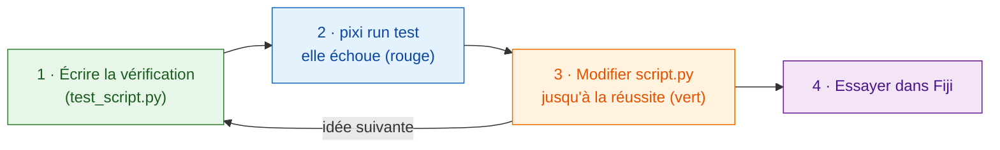

# D'abord le test

!!! success "Vivement recommandé : commencez chaque modification ici"
    Vous *pouvez* sauter les tests et aller directement dans Fiji. Mais écrire
    la vérification **avant** le code est l'habitude qui fait gagner le plus de
    temps, et elle compte surtout quand un **assistant IA** écrit le code pour
    vous (voir plus bas).

## L'idée en mots simples

Un chef décide du goût que doit avoir le plat **avant** de cuisiner, puis
goûte au fur et à mesure. Un **test**, c'est cette décision mise par écrit :
une toute petite vérification qui lance votre fonction `run` sur une image
inventée et répond *réussi* ou *échoué*, **sans ouvrir Fiji**. L'écrire en
premier s'appelle le *développement piloté par les tests* (en anglais
*test-driven development*, TDD).

Wavu vous donne une doublure de Fiji, `FakeCtx`, qui enregistre les messages
du Log et la progression au lieu de les afficher.



Pourquoi d'abord ? Une vérification écrite *après* le code a tendance à
tester ce que fait le code, pas ce que vous vouliez. Écrite en premier, elle
est votre plan ; un résultat rouge avant de commencer prouve que la
vérification regarde vraiment quelque chose.

## À quoi ressemble un test

Le modèle en contient déjà quelques-uns, dans `test_script.py` :

```python
from pathlib import Path
import numpy as np
from wavu.testing import FakeCtx, run_script

SCRIPT = Path(__file__).with_name("script.py")


def test_blur_smooths_a_single_bright_pixel():
    img = np.zeros((32, 32), dtype=np.uint16)
    img[16, 16] = 1000                         # un seul point brillant
    ctx = FakeCtx()
    out = run_script(SCRIPT, {"image": img}, {"sigma": 2.0}, ctx=ctx)

    assert out["blurred"].shape == img.shape   # même taille au retour
    assert out["blurred"][16, 16] < 1000       # le point s'est adouci
    assert ctx.progress_values[-1] == 1.0      # la progression a atteint 100 %
```

- `run_script` appelle votre `run` exactement comme Fiji le ferait, en
  prenant les valeurs par défaut de `PARAMS` pour tout ce que vous omettez.
- `ctx.messages` contient tout ce que vous avez écrit dans le Log ;
  `ctx.progress_values`, chaque valeur de progression.
- `FakeCtx(cancel_after=2)` fait comme si l'utilisateur avait appuyé sur
  Échap après deux vérifications : vous pouvez ainsi tester que l'annulation
  fonctionne.

**Votre premier test** pour une nouvelle idée peut être aussi petit que
ceci : fabriquez une image dont vous connaissez la réponse (un carré
brillant, deux taches séparées), et vérifiez cette réponse
(`labels.max() == 2`).

## Lancer les tests { #run-the-tests }

C'est le seul endroit où un terminal est le plus simple. Dans VS Code,
choisissez **Terminal › New Terminal** (il s'ouvre dans votre dossier de
script) et tapez :

```sh
pixi run test
```

Vous devriez voir une courte ligne de points et un résumé comme
`3 passed in 1.2s`. Un `F` rouge et `failed` veulent dire qu'une
vérification n'a pas tenu ; le texte au-dessus indique quelle ligne et
pourquoi.

!!! tip "Pas de `pixi` dans le terminal ?"
    Le pixi téléchargé par Fiji est rangé à l'écart. Pour le terminal,
    installez pixi une fois depuis [pixi.sh](https://pixi.sh), puis fermez et
    rouvrez le terminal.

    === "Windows"

        ```powershell
        powershell -ExecutionPolicy ByPass -c "irm -useb https://pixi.sh/install.ps1 | iex"
        ```

    === "macOS / Linux"

        ```sh
        curl -fsSL https://pixi.sh/install.sh | sh
        ```

    Ensuite, `pixi --version` affiche un numéro de version.

## Travailler avec un assistant IA

Les assistants de code (Claude, Copilot, ChatGPT…) écrivent vite et ont
l'air sûrs d'eux, même quand le code est faux. Un test est une promesse
qu'ils ne peuvent pas contourner par de belles paroles :

1. **Vous** écrivez ou validez le test : l'image d'entrée et la réponse que
   vous attendez.
2. Demandez à l'assistant : *« fais passer `pixi run test` sans modifier les
   tests. »*
3. **Lancez les tests vous-même** avant de faire confiance au résultat, puis
   essayez dans Fiji.

Lisez les tests écrits par l'assistant aussi attentivement que son code :
une vérification qui ne peut jamais échouer ne protège rien.

## En une phrase

Écrivez d'abord la vérification, regardez-la échouer, modifiez `script.py`
jusqu'à ce que `pixi run test` réussisse, et seulement ensuite essayez dans
Fiji.

[Suite : du notebook à Wavu :material-arrow-right:](from-notebook.md){ .md-button }
