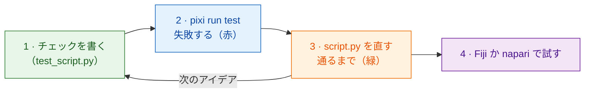

# まずテストから

!!! success "強くおすすめ：どの変更もここから始めましょう"
    テストを飛ばして、いきなり Fiji や napari で試すことも *できます*。でも、コードより
    **先に** チェックを書く習慣は、いちばん時間の節約になります。特に
    **AI アシスタント** にコードを書いてもらうときに大切です（下を参照）。

## やさしく言うと

料理人は料理を作る **前に** どんな味にするかを決め、作りながら味見をします。
**テスト** は、その決めごとを書き留めたものです。作り物の画像で `run` 関数を
動かし、*合格* か *不合格* かを **Fiji も napari も開かずに** 教えてくれる
小さなチェックです。これを先に書くやり方を *テスト駆動開発*（TDD）と呼びます。

Wavu はビューアーの代役 `FakeCtx` を用意しています。これはログのメッセージや
進捗を表示する代わりに記録します。同じスクリプトがどちらのビューアーでも
動くので、1 組のテストで両方を確かめられます。



なぜ先に書くのでしょう？ コードの *後で* 書いたチェックは、あなたが望んだ
ことではなく、コードがしていることを確かめがちです。先に書けば、それが
あなたの計画になります。始める前に赤い結果が出れば、チェックが本当に
何かを見ている証拠になります。

## テストはこんな形

テンプレートの `test_script.py` に、すでにいくつか入っています。

```python
from pathlib import Path
import numpy as np
from wavu.testing import FakeCtx, run_script

SCRIPT = Path(__file__).with_name("script.py")


def test_blur_smooths_a_single_bright_pixel():
    img = np.zeros((32, 32), dtype=np.uint16)
    img[16, 16] = 1000                         # 明るい点が 1 つ
    ctx = FakeCtx()
    out = run_script(SCRIPT, {"image": img}, {"sigma": 2.0}, ctx=ctx)

    assert out["blurred"].shape == img.shape   # 同じ大きさで戻る
    assert out["blurred"][16, 16] < 1000       # 点がやわらかくなった
    assert ctx.progress_values[-1] == 1.0      # 進捗が 100 % に届いた
```

- `run_script` は、Fiji や napari と同じように `run` を呼びます。指定
  しなかったものは `PARAMS` の既定値で埋めます。
- `ctx.messages` にはログに書いたものすべてが、`ctx.progress_values` には
  すべての進捗の値が入っています。
- `FakeCtx(cancel_after=2)` は、2 回確認した後にユーザーがキャンセルした
  （Fiji なら Esc、napari なら **Cancel**）ふりをします。キャンセルが効くかを
  テストできます。

新しいアイデアの **最初のテスト** は、これくらい小さくて構いません。答えが
わかっている画像（明るい四角が 1 つ、離れた塊が 2 つ）を作り、その答え
（`labels.max() == 2`）を assert（確認）します。

## テストを実行する { #run-the-tests }

ここはターミナルを使うのが一番簡単な場面です。VS Code で
**Terminal › New Terminal**（新しいターミナル）を選び（スクリプトフォルダーで
開きます）、次のように入力します。

```sh
pixi run test
```

短い点の列と、`3 passed in 1.2s` のようなまとめが表示されるはずです。
赤い `F` と `failed` は、チェックが通らなかったという意味です。その上の
文章に、どの行でなぜ失敗したかが書かれています。

!!! tip "ターミナルに `pixi` がない？"
    Wavu と一緒に napari をインストールした場合は、すでに使えます。
    Fiji がダウンロードした pixi は見えない場所にしまわれています。
    ターミナル用に、[pixi.sh](https://pixi.sh) から一度 pixi をインストール
    し、ターミナルを閉じて開き直してください。

    === "Windows"

        ```powershell
        powershell -ExecutionPolicy ByPass -c "irm -useb https://pixi.sh/install.ps1 | iex"
        ```

    === "macOS / Linux"

        ```sh
        curl -fsSL https://pixi.sh/install.sh | sh
        ```

    その後、`pixi --version` でバージョン番号が表示されます。

## AI アシスタントと一緒に作業する

コーディングアシスタント（Claude、Copilot、ChatGPT など）は、コードを速く
書き、間違っていても自信たっぷりに見えます。テストは、口先ではごまかせない
約束です。

1. **あなた** がテストを書くか、承認します。入力画像と、期待する答えです。
2. アシスタントに *「テストは変えずに、`pixi run test` が通るように
   してください」* と頼みます。
3. 結果を信じる前に **自分でテストを実行し**、それから Fiji や napari で試します。

アシスタントが書いたテストも、コードと同じくらい注意して読みましょう。
決して失敗しないチェックは、何も守ってくれません。

## ひとことで言うと

まずチェックを書き、失敗するのを確かめ、`pixi run test` が通るまで
`script.py` を直し、それから初めて Fiji や napari で試します。

[次へ：ノートブックから Wavu へ :material-arrow-right:](from-notebook.md){ .md-button }
