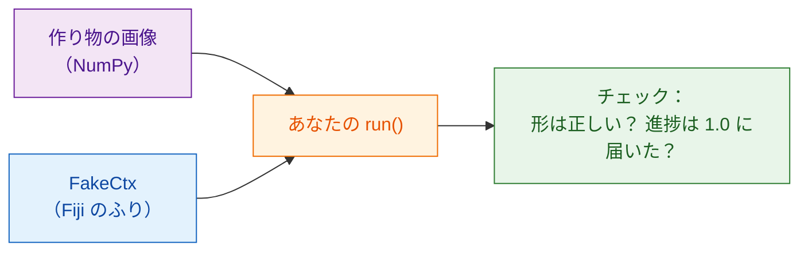

# Fiji なしでテストする

!!! note "任意"
    これをしなくても、役に立つスクリプトは書けます。スクリプトが大きく
    なってきたときや、共有する前にやると効果があります。

## やさしく言うと

料理人は、ソースを出す前に味見をします。お客さんのテーブルで間違いが
見つかるのは誰も望みません。**テスト** は小さなチェックで、作り物の画像で
`run` 関数を動かし、答えが正しそうかを **Fiji を開かずに** 確かめます。
Wavu は Fiji の代役 `FakeCtx` を用意しています。これはログのメッセージや
進捗を表示する代わりに記録します。



## テストはこんな形

テンプレートの `test_script.py` に、すでに 1 つ入っています。

```python
from pathlib import Path
import numpy as np
from wavu.testing import FakeCtx, run_script

SCRIPT = Path(__file__).with_name("script.py")


def test_blur_smooths_a_single_bright_pixel():
    img = np.zeros((32, 32), dtype=np.uint16)
    img[16, 16] = 1000                         # 明るい点が 1 つ
    ctx = FakeCtx()
    out = run_script(SCRIPT, {"image": img}, {"sigma": 2.0}, ctx=ctx)

    assert out["blurred"].shape == img.shape   # 同じ大きさで戻る
    assert out["blurred"][16, 16] < 1000       # 点がやわらかくなった
    assert ctx.progress_values[-1] == 1.0      # 進捗が 100 % に届いた
```

- `run_script` は、Fiji と同じように `run` を呼びます。指定しなかったものは
  `PARAMS` の既定値で埋めます。
- `ctx.messages` にはログに書いたものすべてが、`ctx.progress_values` には
  すべての進捗の値が入っています。
- `FakeCtx(cancel_after=2)` は、2 回確認した後にユーザーが Esc を押した
  ふりをします。キャンセルが効くかをテストできます。

## テストを実行する { #run-the-tests }

ここはターミナルを使うのが一番簡単な場面です。VS Code で
**Terminal › New Terminal**（新しいターミナル）を選び（スクリプトフォルダーで
開きます）、次のように入力します。

```sh
pixi run test
```

短い点の列と、`3 passed in 1.2s` のようなまとめが表示されるはずです。
赤い `F` と `failed` は、チェックが通らなかったという意味です。その上の
文章に、どの行でなぜ失敗したかが書かれています。

!!! tip "ターミナルに `pixi` がない？"
    Fiji がダウンロードした pixi は見えない場所にしまわれています。
    ターミナル用に、[pixi.sh](https://pixi.sh) から一度 pixi をインストール
    し、ターミナルを閉じて開き直してください。

    === "Windows"

        ```powershell
        powershell -ExecutionPolicy ByPass -c "irm -useb https://pixi.sh/install.ps1 | iex"
        ```

    === "macOS / Linux"

        ```sh
        curl -fsSL https://pixi.sh/install.sh | sh
        ```

    その後、`pixi --version` でバージョン番号が表示されます。

## 実際の画像でテストする

TIFF ファイルを使って、Fiji なしでスクリプト全体を試し、結果をフォルダーに
保存することもできます。

```sh
pixi run wavu run script.py --in image=cells.tif --param sigma=3 --out results
```

## ひとことで言うと

`FakeCtx` と `run_script` を使えば、`pixi run test` で小さな作り物の画像を
使って `run` をチェックできます。Fiji や同僚が見る前に、間違いが見つかります。

[次へ：研究室で共有する :material-arrow-right:](../share/with-your-lab.md){ .md-button }
