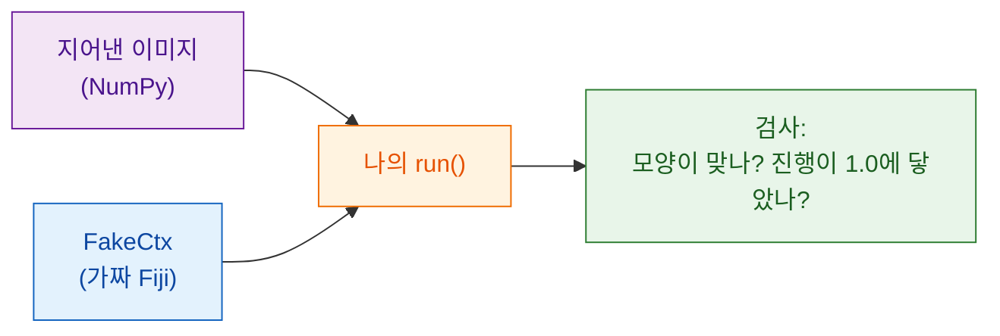

# Fiji 없이 테스트하기

!!! note "선택 사항"
    이걸 하지 않아도 쓸모 있는 스크립트를 만들 수 있어요. 스크립트가
    커지거나 공유하기 전이라면 해 둘 만해요.

## 쉬운 말로 설명하면

요리사는 소스를 내보내기 전에 맛을 봐요. 손님 테이블에서 실수를 발견하고
싶은 사람은 없으니까요. **테스트**는 지어낸 이미지로 `run` 함수를 돌려서
답이 맞아 보이는지 확인하는 작은 검사예요. **Fiji를 열지 않고요.** Wavu는
Fiji를 대신하는 `FakeCtx`를 줘요. 로그 메시지와 진행 상황을 보여 주는
대신 기록해 둬요.



## 테스트는 이렇게 생겼어요

템플릿의 `test_script.py`에 이미 하나 있어요.

```python
from pathlib import Path
import numpy as np
from wavu.testing import FakeCtx, run_script

SCRIPT = Path(__file__).with_name("script.py")


def test_blur_smooths_a_single_bright_pixel():
    img = np.zeros((32, 32), dtype=np.uint16)
    img[16, 16] = 1000                         # 밝은 점 하나
    ctx = FakeCtx()
    out = run_script(SCRIPT, {"image": img}, {"sigma": 2.0}, ctx=ctx)

    assert out["blurred"].shape == img.shape   # 같은 크기로 돌아옴
    assert out["blurred"][16, 16] < 1000       # 점이 부드러워짐
    assert ctx.progress_values[-1] == 1.0      # 진행이 100 %에 닿음
```

- `run_script`는 Fiji가 하듯이 `run`을 불러요. 빠뜨린 값은 `PARAMS`의
  기본값으로 채워요.
- `ctx.messages`에는 로그로 남긴 모든 것이, `ctx.progress_values`에는 모든
  진행 값이 들어 있어요.
- `FakeCtx(cancel_after=2)`는 확인 두 번 뒤에 사용자가 Esc를 누른 척해요.
  취소가 잘 되는지 테스트할 수 있어요.

## 테스트 실행하기 { #run-the-tests }

여기는 터미널이 가장 간단한 유일한 곳이에요. VS Code에서
**Terminal › New Terminal**을 고르고(스크립트 폴더에서 열려요) 이렇게
입력하세요.

```sh
pixi run test
```

짧은 점들과 `3 passed in 1.2s` 같은 요약이 보이면 돼요. 빨간 `F`와
`failed`는 검사 하나가 맞지 않았다는 뜻이에요. 그 위의 글이 어느 줄인지,
왜인지 알려 줘요.

!!! tip "터미널에 `pixi`가 없나요?"
    Fiji가 내려받은 pixi는 눈에 띄지 않는 곳에 있어요. 터미널용으로는
    [pixi.sh](https://pixi.sh)에서 pixi를 한 번 설치하고, 터미널을 닫았다가
    다시 여세요.

    === "Windows"

        ```powershell
        powershell -ExecutionPolicy ByPass -c "irm -useb https://pixi.sh/install.ps1 | iex"
        ```

    === "macOS / Linux"

        ```sh
        curl -fsSL https://pixi.sh/install.sh | sh
        ```

    그다음 `pixi --version`을 치면 버전 번호가 나와요.

## 실제 이미지로 테스트하기

Fiji 없이 TIFF 파일로 스크립트 전체를 돌리고, 결과를 폴더에 저장할 수도 있어요.

```sh
pixi run wavu run script.py --in image=cells.tif --param sigma=3 --out results
```

## 한 문장으로

`FakeCtx`와 `run_script`로 작은 지어낸 이미지에서 `run`을 `pixi run test`로
확인하면, Fiji나 동료가 보기 전에 실수가 드러나요.

[다음: 연구실과 공유하기 :material-arrow-right:](../share/with-your-lab.md){ .md-button }
