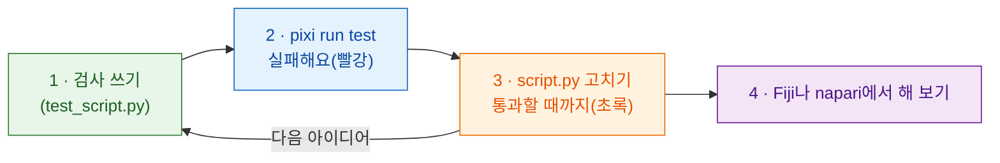

# 테스트 먼저

!!! success "강력 추천: 모든 변경을 여기서 시작하세요"
    테스트를 건너뛰고 바로 Fiji나 napari로 가도 *돼요*. 하지만 코드보다 **먼저**
    검사를 쓰는 습관이 시간을 가장 많이 아껴 줘요. **AI 어시스턴트**가
    코드를 써 줄 때 특히 중요해요(아래 참고).

## 쉬운 말로 설명하면

요리사는 요리하기 **전에** 어떤 맛이어야 하는지 정하고, 요리하면서 맛을
봐요. **테스트**는 그 결정을 적어 둔 거예요. 지어낸 이미지로 `run` 함수를
돌려서 *통과*인지 *실패*인지 알려 주는 작은 검사예요. **Fiji나 napari를
열지 않고요.** 이걸 먼저 쓰는 방식을 *테스트 주도 개발*(TDD)이라고 해요.

Wavu는 뷰어를 대신하는 `FakeCtx`를 줘요. 로그 메시지와 진행 상황을 보여
주는 대신 기록해 둬요. 같은 스크립트가 두 뷰어에서 돌기 때문에, 테스트
한 벌로 둘 다 확인할 수 있어요.



왜 먼저일까요? 코드 *다음에* 쓴 검사는 내가 원한 것이 아니라 코드가 하는
일을 확인하기 쉬워요. 먼저 쓰면 그게 계획이 돼요. 시작하기 전에 빨간
결과가 나오면 검사가 정말 무언가를 보고 있다는 증거예요.

## 테스트는 이렇게 생겼어요

템플릿의 `test_script.py`에 이미 몇 개 있어요.

```python
from pathlib import Path
import numpy as np
from wavu.testing import FakeCtx, run_script

SCRIPT = Path(__file__).with_name("script.py")


def test_blur_smooths_a_single_bright_pixel():
    img = np.zeros((32, 32), dtype=np.uint16)
    img[16, 16] = 1000                         # 밝은 점 하나
    ctx = FakeCtx()
    out = run_script(SCRIPT, {"image": img}, {"sigma": 2.0}, ctx=ctx)

    assert out["blurred"].shape == img.shape   # 같은 크기로 돌아옴
    assert out["blurred"][16, 16] < 1000       # 점이 부드러워짐
    assert ctx.progress_values[-1] == 1.0      # 진행이 100 %에 닿음
```

- `run_script`는 Fiji나 napari가 하듯이 `run`을 불러요. 빠뜨린 값은 `PARAMS`의
  기본값으로 채워요.
- `ctx.messages`에는 로그로 남긴 모든 것이, `ctx.progress_values`에는 모든
  진행 값이 들어 있어요.
- `FakeCtx(cancel_after=2)`는 확인 두 번 뒤에 사용자가 취소한 척해요
  (Fiji에서는 Esc, napari에서는 **Cancel**). 취소가 잘 되는지 테스트할 수
  있어요.

새 아이디어의 **첫 테스트**는 이 정도로 작아도 돼요. 답을 아는 이미지(밝은
네모 하나, 떨어진 덩어리 두 개)를 만들고, 그 답(`labels.max() == 2`)을
assert로 확인하세요.

## 테스트 실행하기 { #run-the-tests }

여기는 터미널이 가장 간단한 유일한 곳이에요. VS Code에서
**Terminal › New Terminal**을 고르고(스크립트 폴더에서 열려요) 이렇게
입력하세요.

```sh
pixi run test
```

짧은 점들과 `3 passed in 1.2s` 같은 요약이 보이면 돼요. 빨간 `F`와
`failed`는 검사 하나가 맞지 않았다는 뜻이에요. 그 위의 글이 어느 줄인지,
왜인지 알려 줘요.

!!! tip "터미널에 `pixi`가 없나요?"
    napari를 Wavu와 함께 설치했다면 이미 있어요. Fiji가 내려받은 pixi는
    눈에 띄지 않는 곳에 있어요. 터미널용으로는
    [pixi.sh](https://pixi.sh)에서 pixi를 한 번 설치하고, 터미널을 닫았다가
    다시 여세요.

    === "Windows"

        ```powershell
        powershell -ExecutionPolicy ByPass -c "irm -useb https://pixi.sh/install.ps1 | iex"
        ```

    === "macOS / Linux"

        ```sh
        curl -fsSL https://pixi.sh/install.sh | sh
        ```

    그다음 `pixi --version`을 치면 버전 번호가 나와요.

## AI 어시스턴트와 함께 작업하기

코딩 어시스턴트(Claude, Copilot, ChatGPT…)는 코드를 빨리 쓰고, 코드가
틀려도 자신 있게 말해요. 테스트는 말로 빠져나갈 수 없는 약속이에요.

1. **내가** 테스트를 쓰거나 승인해요. 입력 이미지와 기대하는 답이에요.
2. 어시스턴트에게 *"테스트는 바꾸지 말고 `pixi run test`가 통과하게
   해 줘."*라고 부탁해요.
3. 결과를 믿기 전에 **직접 테스트를 실행**하고, 그다음 Fiji나 napari에서 해 봐요.

어시스턴트가 쓴 테스트도 코드만큼 꼼꼼히 읽으세요. 절대 실패하지 않는
검사는 아무것도 지켜 주지 못해요.

## 한 문장으로

검사를 먼저 쓰고, 실패하는 걸 확인하고, `pixi run test`가 통과할 때까지
`script.py`를 고친 다음에야 Fiji나 napari에서 해 보세요.

[다음: 노트북에서 Wavu로 :material-arrow-right:](from-notebook.md){ .md-button }
