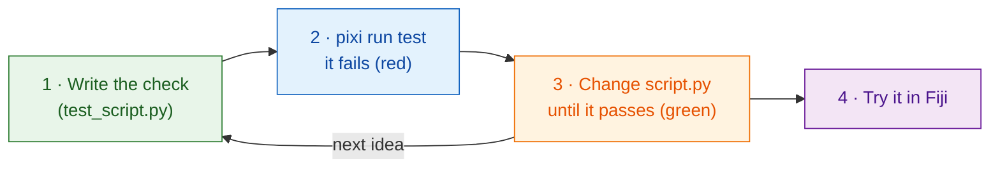

# Test first

!!! success "Strongly recommended: start every change here"
    You *can* skip tests and go straight to Fiji. But writing the check
    **before** the code is the habit that saves the most time, and it matters
    most when an **AI assistant** writes the code for you (see below).

## The idea in plain words

A chef decides how the dish should taste **before** cooking, then tastes as
they go. A **test** is that decision written down: a tiny check that runs your
`run` function on a made-up image and says *pass* or *fail*, **without
opening Fiji**. Writing it first is called *test-driven development* (TDD).

Wavu gives you a stand-in for Fiji, `FakeCtx`, that records log messages and
progress instead of showing them.



Why first? A check written *after* the code tends to test what the code
does, not what you wanted. Written first, it is your plan; a red result
before you start proves the check really looks at something.

## What a test looks like

The template already has some, in `test_script.py`:

```python
from pathlib import Path
import numpy as np
from wavu.testing import FakeCtx, run_script

SCRIPT = Path(__file__).with_name("script.py")


def test_blur_smooths_a_single_bright_pixel():
    img = np.zeros((32, 32), dtype=np.uint16)
    img[16, 16] = 1000                         # one bright dot
    ctx = FakeCtx()
    out = run_script(SCRIPT, {"image": img}, {"sigma": 2.0}, ctx=ctx)

    assert out["blurred"].shape == img.shape   # same size back
    assert out["blurred"][16, 16] < 1000       # the dot got softer
    assert ctx.progress_values[-1] == 1.0      # progress reached 100 %
```

- `run_script` calls your `run` just as Fiji would, filling in the defaults
  from `PARAMS` for anything you leave out.
- `ctx.messages` holds everything you logged; `ctx.progress_values` every
  progress value.
- `FakeCtx(cancel_after=2)` pretends the user pressed Esc after two checks,
  so you can test that cancel works.

**Your first test** for a new idea can be this small: make an image where
you know the answer (one bright square, two separate blobs), and assert the
answer (`labels.max() == 2`).

## Run the tests { #run-the-tests }

This is the one place where a terminal is the simplest way. In VS Code
choose **Terminal › New Terminal** (it opens in your script folder) and
type:

```sh
pixi run test
```

You should see a short line of dots and a summary such as
`3 passed in 1.2s`. A red `F` and `failed` means a check did not hold; the
text above it says which line and why.

!!! tip "No `pixi` in the terminal?"
    The pixi that Fiji downloaded is kept out of sight. For the terminal,
    install pixi once from [pixi.sh](https://pixi.sh), then close and reopen
    the terminal.

    === "Windows"

        ```powershell
        powershell -ExecutionPolicy ByPass -c "irm -useb https://pixi.sh/install.ps1 | iex"
        ```

    === "macOS / Linux"

        ```sh
        curl -fsSL https://pixi.sh/install.sh | sh
        ```

    Afterwards `pixi --version` prints a version number.

## Working with an AI assistant

Coding assistants (Claude, Copilot, ChatGPT…) write code fast and sound
sure of themselves, even when the code is wrong. A test is a promise they
cannot talk their way around:

1. **You** write or approve the test: the input image and the answer you
   expect.
2. Ask the assistant: *"make `pixi run test` pass without changing the
   tests."*
3. **Run the tests yourself** before you trust the result, then try it in
   Fiji.

Read the tests the assistant writes as carefully as its code: a check that
can never fail protects nothing.

## In one sentence

Write the check first, watch it fail, change `script.py` until
`pixi run test` passes, and only then try it in Fiji.

[Next: from notebook to Wavu :material-arrow-right:](from-notebook.md){ .md-button }
