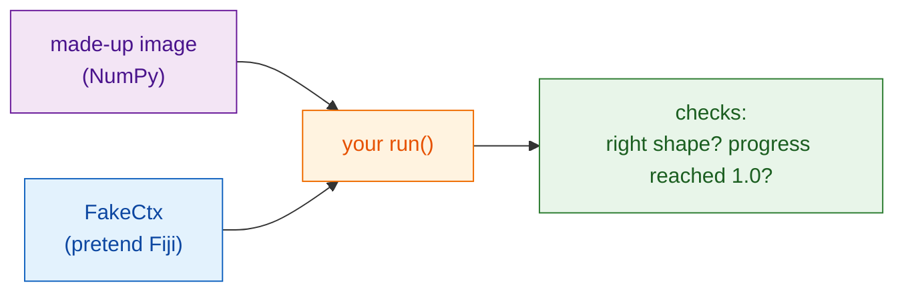

# Test without Fiji

!!! note "Optional"
    You can write useful scripts without ever doing this. It pays off once
    your script grows, or before you share it.

## The idea in plain words

A chef tastes the sauce before it goes out; nobody wants to find the
mistake at the customer's table. A **test** is a tiny check that runs your
`run` function on a made-up image and confirms the answer looks right,
**without opening Fiji**. Wavu gives you a stand-in for Fiji, `FakeCtx`,
that records the log messages and progress instead of showing them.



## What a test looks like

The template already has one, in `test_script.py`:

```python
from pathlib import Path
import numpy as np
from wavu.testing import FakeCtx, run_script

SCRIPT = Path(__file__).with_name("script.py")


def test_blur_smooths_a_single_bright_pixel():
    img = np.zeros((32, 32), dtype=np.uint16)
    img[16, 16] = 1000                         # one bright dot
    ctx = FakeCtx()
    out = run_script(SCRIPT, {"image": img}, {"sigma": 2.0}, ctx=ctx)

    assert out["blurred"].shape == img.shape   # same size back
    assert out["blurred"][16, 16] < 1000       # the dot got softer
    assert ctx.progress_values[-1] == 1.0      # progress reached 100 %
```

- `run_script` calls your `run` just as Fiji would, filling in the defaults
  from `PARAMS` for anything you leave out.
- `ctx.messages` holds everything you logged; `ctx.progress_values` every
  progress value.
- `FakeCtx(cancel_after=2)` pretends the user pressed Esc after two checks,
  so you can test that cancel works.

## Run the tests

This is the one place where a terminal is the simplest way. In VS Code
choose **Terminal › New Terminal** (it opens in your script folder) and
type:

```sh
pixi run test
```

You should see a short line of dots and a summary such as
`3 passed in 1.2s`. A red `F` and `failed` means a check did not hold; the
text above it says which line and why.

!!! tip "No `pixi` in the terminal?"
    The pixi that Fiji downloaded is kept out of sight. For the terminal,
    install pixi once from [pixi.sh](https://pixi.sh), then close and reopen
    the terminal.

    === "Windows"

        ```powershell
        powershell -ExecutionPolicy ByPass -c "irm -useb https://pixi.sh/install.ps1 | iex"
        ```

    === "macOS / Linux"

        ```sh
        curl -fsSL https://pixi.sh/install.sh | sh
        ```

    Afterwards `pixi --version` prints a version number.

## Testing on a real image

You can also try the whole script on a TIFF file, without Fiji, and save the
results to a folder:

```sh
pixi run wavu run script.py --in image=cells.tif --param sigma=3 --out results
```

## In one sentence

`FakeCtx` and `run_script` let you check `run` on a small made-up image with
`pixi run test`, so mistakes show up before Fiji or a colleague sees them.

[Next: share with your lab :material-arrow-right:](../share/with-your-lab.md){ .md-button }
