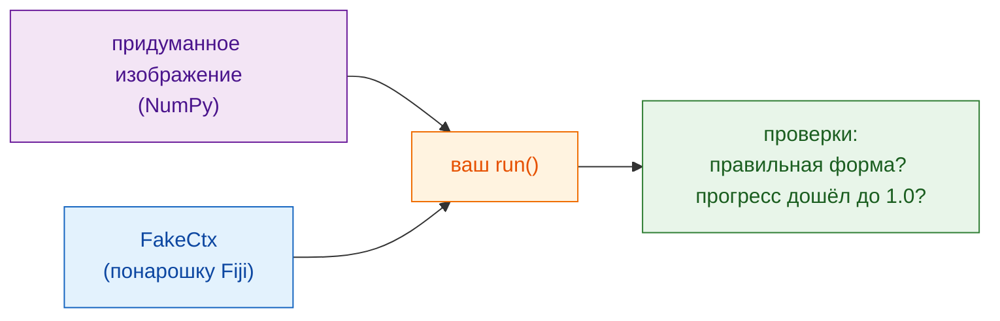

# Проверка без Fiji

!!! note "По желанию"
    Полезные скрипты можно писать и без этого. Это окупается, когда скрипт
    разрастается или перед тем, как им поделиться.

## Идея простыми словами

Повар пробует соус, прежде чем его подать: никто не хочет найти ошибку за
столиком гостя. **Тест** — это маленькая проверка, которая запускает вашу
функцию `run` на придуманном изображении и подтверждает, что ответ выглядит
правильно, **не открывая Fiji**. Wavu даёт вам замену Fiji, `FakeCtx`,
которая записывает сообщения Log и прогресс вместо того, чтобы их показывать.



## Как выглядит тест

В шаблоне один уже есть, в `test_script.py`:

```python
from pathlib import Path
import numpy as np
from wavu.testing import FakeCtx, run_script

SCRIPT = Path(__file__).with_name("script.py")


def test_blur_smooths_a_single_bright_pixel():
    img = np.zeros((32, 32), dtype=np.uint16)
    img[16, 16] = 1000                         # одна яркая точка
    ctx = FakeCtx()
    out = run_script(SCRIPT, {"image": img}, {"sigma": 2.0}, ctx=ctx)

    assert out["blurred"].shape == img.shape   # вернулся тот же размер
    assert out["blurred"][16, 16] < 1000       # точка стала мягче
    assert ctx.progress_values[-1] == 1.0      # прогресс дошёл до 100 %
```

- `run_script` вызывает ваш `run` так же, как Fiji, подставляя значения по
  умолчанию из `PARAMS` для всего, что вы не указали.
- В `ctx.messages` — всё, что вы записали в Log; в `ctx.progress_values` —
  все значения прогресса.
- `FakeCtx(cancel_after=2)` изображает нажатие Esc после двух проверок,
  чтобы можно было проверить, что отмена работает.

## Запуск тестов { #run-the-tests }

Это единственное место, где терминал — самый простой путь. В VS Code
выберите **Terminal › New Terminal** (он откроется в папке скрипта) и
введите:

```sh
pixi run test
```

Вы увидите короткую строку точек и итог вроде `3 passed in 1.2s`. Красная
`F` и `failed` означают, что проверка не прошла; текст над ней говорит, в
какой строке и почему.

!!! tip "В терминале нет `pixi`?"
    pixi, который скачал Fiji, спрятан. Для терминала один раз установите
    pixi с [pixi.sh](https://pixi.sh), затем закройте и снова откройте
    терминал.

    === "Windows"

        ```powershell
        powershell -ExecutionPolicy ByPass -c "irm -useb https://pixi.sh/install.ps1 | iex"
        ```

    === "macOS / Linux"

        ```sh
        curl -fsSL https://pixi.sh/install.sh | sh
        ```

    После этого `pixi --version` выведет номер версии.

## Проверка на настоящем изображении

Можно также опробовать весь скрипт на TIFF-файле, без Fiji, и сохранить
результаты в папку:

```sh
pixi run wavu run script.py --in image=cells.tif --param sigma=3 --out results
```

## Одним предложением

`FakeCtx` и `run_script` позволяют проверить `run` на маленьком придуманном
изображении командой `pixi run test`, чтобы ошибки всплыли раньше, чем их
увидит Fiji или коллега.

[Далее: поделиться с лабораторией :material-arrow-right:](../share/with-your-lab.md){ .md-button }
