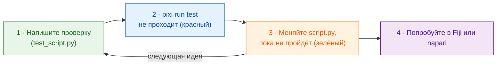

# Сначала тест

!!! success "Настоятельно рекомендуется: начинайте отсюда каждое изменение"
    Тесты *можно* пропустить и сразу перейти к Fiji или napari. Но привычка писать
    проверку **до** кода экономит больше всего времени, и особенно она важна,
    когда код за вас пишет **ИИ-ассистент** (см. ниже).

## Идея простыми словами

Повар решает, каким должно быть блюдо на вкус, **до** того как начать
готовить, а потом пробует по ходу дела. **Тест** — это такое решение,
записанное на бумаге: маленькая проверка, которая запускает вашу функцию
`run` на придуманном изображении и говорит *прошло* или *не прошло*,
**не открывая ни Fiji, ни napari**. Когда тест пишут первым, это называется *разработкой
через тестирование* (TDD, от англ. *test-driven development*).

Wavu даёт вам замену просмотрщика, `FakeCtx`, которая записывает сообщения
журнала и прогресс вместо того, чтобы их показывать. Поскольку один и тот же
скрипт работает в обоих просмотрщиках, один набор тестов покрывает оба.



Почему сначала? Проверка, написанная *после* кода, обычно проверяет то, что
код делает, а не то, чего вы хотели. Написанная первой, она становится вашим
планом; красный результат до начала работы доказывает, что проверка
действительно что-то смотрит.

## Как выглядит тест

В шаблоне несколько уже есть, в `test_script.py`:

```python
from pathlib import Path
import numpy as np
from wavu.testing import FakeCtx, run_script

SCRIPT = Path(__file__).with_name("script.py")


def test_blur_smooths_a_single_bright_pixel():
    img = np.zeros((32, 32), dtype=np.uint16)
    img[16, 16] = 1000                         # одна яркая точка
    ctx = FakeCtx()
    out = run_script(SCRIPT, {"image": img}, {"sigma": 2.0}, ctx=ctx)

    assert out["blurred"].shape == img.shape   # вернулся тот же размер
    assert out["blurred"][16, 16] < 1000       # точка стала мягче
    assert ctx.progress_values[-1] == 1.0      # прогресс дошёл до 100 %
```

- `run_script` вызывает ваш `run` так же, как Fiji или napari, подставляя значения по
  умолчанию из `PARAMS` для всего, что вы не указали.
- В `ctx.messages` — всё, что вы записали в журнал; в `ctx.progress_values` —
  все значения прогресса.
- `FakeCtx(cancel_after=2)` изображает отмену пользователем (Esc в Fiji,
  **Cancel** в napari) после двух проверок, чтобы можно было проверить, что
  отмена работает.

**Ваш первый тест** для новой идеи может быть совсем маленьким: создайте
изображение, ответ для которого вы знаете (один яркий квадрат, два отдельных
пятна), и проверьте этот ответ (`labels.max() == 2`).

## Запуск тестов { #run-the-tests }

Это единственное место, где терминал — самый простой путь. В VS Code
выберите **Terminal › New Terminal** (он откроется в папке скрипта) и
введите:

```sh
pixi run test
```

Вы увидите короткую строку точек и итог вроде `3 passed in 1.2s`. Красная
`F` и `failed` означают, что проверка не прошла; текст над ней говорит, в
какой строке и почему.

!!! tip "В терминале нет `pixi`?"
    Если вы установили napari вместе с Wavu, он у вас уже есть. pixi, который
    скачал Fiji, спрятан. Для терминала один раз установите
    pixi с [pixi.sh](https://pixi.sh), затем закройте и снова откройте
    терминал.

    === "Windows"

        ```powershell
        powershell -ExecutionPolicy ByPass -c "irm -useb https://pixi.sh/install.ps1 | iex"
        ```

    === "macOS / Linux"

        ```sh
        curl -fsSL https://pixi.sh/install.sh | sh
        ```

    После этого `pixi --version` выведет номер версии.

## Работа с ИИ-ассистентом

Ассистенты для программирования (Claude, Copilot, ChatGPT…) пишут код быстро
и звучат уверенно, даже когда код неверен. Тест — это обещание, которое
нельзя обойти уговорами:

1. **Вы** пишете или одобряете тест: входное изображение и ожидаемый ответ.
2. Попросите ассистента: *«сделай так, чтобы `pixi run test` проходил, не
   меняя тесты»*.
3. **Запустите тесты сами**, прежде чем доверять результату, а затем
   попробуйте в Fiji или napari.

Читайте тесты, которые пишет ассистент, так же внимательно, как его код:
проверка, которая никогда не может не пройти, ничего не защищает.

## Одним предложением

Сначала напишите проверку, убедитесь, что она не проходит, меняйте
`script.py`, пока `pixi run test` не пройдёт, и только потом пробуйте в Fiji или napari.

[Далее: от ноутбука к Wavu :material-arrow-right:](from-notebook.md){ .md-button }
