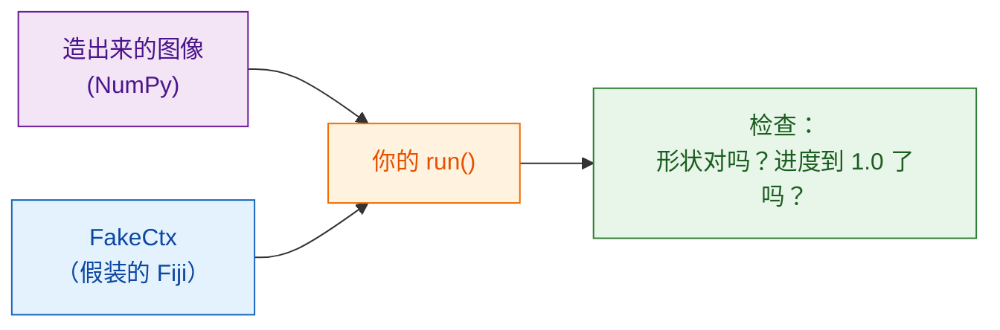

# 不用 Fiji 也能测试

!!! note "可选"
    就算从来不做这一步，你也能写出好用的脚本。等脚本变大，或者在分享之前，它就很有价值了。

## 用大白话说

厨师上菜前会先尝一口酱汁；谁都不想在客人的餐桌上才发现问题。
**测试**就是一个小检查：用一张自己造的图像跑一下你的 `run` 函数，确认结果看起来没错，
而且**根本不用打开 Fiji**。Wavu 提供了一个 Fiji 的替身 `FakeCtx`，
它把日志消息和进度记录下来，而不是显示出来。



## 测试长什么样

模板里已经有一个，在 `test_script.py` 中：

```python
from pathlib import Path
import numpy as np
from wavu.testing import FakeCtx, run_script

SCRIPT = Path(__file__).with_name("script.py")


def test_blur_smooths_a_single_bright_pixel():
    img = np.zeros((32, 32), dtype=np.uint16)
    img[16, 16] = 1000                         # 一个亮点
    ctx = FakeCtx()
    out = run_script(SCRIPT, {"image": img}, {"sigma": 2.0}, ctx=ctx)

    assert out["blurred"].shape == img.shape   # 返回的尺寸不变
    assert out["blurred"][16, 16] < 1000       # 亮点变柔和了
    assert ctx.progress_values[-1] == 1.0      # 进度到了 100 %
```

- `run_script` 会像 Fiji 一样调用你的 `run`，你没给的参数会用 `PARAMS`
  里的默认值补上。
- `ctx.messages` 存着你写过的所有日志；`ctx.progress_values` 存着每个进度值。
- `FakeCtx(cancel_after=2)` 会假装用户在两次检查之后按了 Esc，
  方便你测试取消是否正常。

## 运行测试 { #run-the-tests }

这是唯一一个用终端最省事的地方。在 VS Code 里选
**Terminal › New Terminal**（它会在你的脚本文件夹里打开），然后输入：

```sh
pixi run test
```

你应该会看到一小串点，以及类似 `3 passed in 1.2s` 的汇总。
如果出现红色的 `F` 和 `failed`，说明有一项检查没通过；上面的文字会告诉你是哪一行、为什么。

!!! tip "终端里没有 `pixi`？"
    Fiji 下载的 pixi 放在看不见的地方。要在终端里用，请从
    [pixi.sh](https://pixi.sh) 安装一次 pixi，然后关闭终端再重新打开。

    === "Windows"

        ```powershell
        powershell -ExecutionPolicy ByPass -c "irm -useb https://pixi.sh/install.ps1 | iex"
        ```

    === "macOS / Linux"

        ```sh
        curl -fsSL https://pixi.sh/install.sh | sh
        ```

    之后运行 `pixi --version` 会打印出版本号。

## 用真实图像测试

你也可以不开 Fiji，直接拿一个 TIFF 文件试跑整个脚本，并把结果保存到一个文件夹：

```sh
pixi run wavu run script.py --in image=cells.tif --param sigma=3 --out results
```

## 一句话总结

`FakeCtx` 和 `run_script` 让你用 `pixi run test` 在一张小小的假图像上检查
`run`，问题就会在 Fiji 或同事看到之前暴露出来。

[下一步：分享给实验室 :material-arrow-right:](../share/with-your-lab.md){ .md-button }
