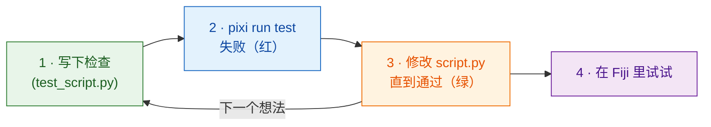

# 先写测试

!!! success "强烈推荐：每次修改都从这里开始"
    你*可以*跳过测试，直接去 Fiji 里试。但在写代码**之前**先写好检查，
    是最省时间的习惯；当代码由 **AI 助手**替你来写时，这一点尤其重要（见下文）。

## 用大白话说

厨师在下锅**之前**就想好这道菜该是什么味道，然后边做边尝。
**测试**就是把这个决定写下来：一个小检查，用一张自己造的图像跑一下你的
`run` 函数，告诉你*通过*还是*失败*，而且**根本不用打开 Fiji**。
先写测试再写代码，叫作*测试驱动开发*（test-driven development，TDD）。

Wavu 提供了一个 Fiji 的替身 `FakeCtx`，它把日志消息和进度记录下来，
而不是显示出来。



为什么要先写？代码写完*之后*才写的检查，往往只是在测代码做了什么，
而不是你想让它做什么。先写的话，它就是你的计划；动手之前先看到红色，
也证明这个检查确实在检查东西。

## 测试长什么样

模板里已经有几个，在 `test_script.py` 中：

```python
from pathlib import Path
import numpy as np
from wavu.testing import FakeCtx, run_script

SCRIPT = Path(__file__).with_name("script.py")


def test_blur_smooths_a_single_bright_pixel():
    img = np.zeros((32, 32), dtype=np.uint16)
    img[16, 16] = 1000                         # 一个亮点
    ctx = FakeCtx()
    out = run_script(SCRIPT, {"image": img}, {"sigma": 2.0}, ctx=ctx)

    assert out["blurred"].shape == img.shape   # 返回的尺寸不变
    assert out["blurred"][16, 16] < 1000       # 亮点变柔和了
    assert ctx.progress_values[-1] == 1.0      # 进度到了 100 %
```

- `run_script` 会像 Fiji 一样调用你的 `run`，你没给的参数会用 `PARAMS`
  里的默认值补上。
- `ctx.messages` 存着你写过的所有日志；`ctx.progress_values` 存着每个进度值。
- `FakeCtx(cancel_after=2)` 会假装用户在两次检查之后按了 Esc，
  方便你测试取消是否正常。

为新想法写的**第一个测试**可以就这么小：造一张你已经知道答案的图像
（一个亮方块、两个分开的斑点），然后断言（assert）这个答案
（`labels.max() == 2`）。

## 运行测试 { #run-the-tests }

这是唯一一个用终端最省事的地方。在 VS Code 里选
**Terminal › New Terminal**（它会在你的脚本文件夹里打开），然后输入：

```sh
pixi run test
```

你应该会看到一小串点，以及类似 `3 passed in 1.2s` 的汇总。
如果出现红色的 `F` 和 `failed`，说明有一项检查没通过；上面的文字会告诉你是哪一行、为什么。

!!! tip "终端里没有 `pixi`？"
    Fiji 下载的 pixi 放在看不见的地方。要在终端里用，请从
    [pixi.sh](https://pixi.sh) 安装一次 pixi，然后关闭终端再重新打开。

    === "Windows"

        ```powershell
        powershell -ExecutionPolicy ByPass -c "irm -useb https://pixi.sh/install.ps1 | iex"
        ```

    === "macOS / Linux"

        ```sh
        curl -fsSL https://pixi.sh/install.sh | sh
        ```

    之后运行 `pixi --version` 会打印出版本号。

## 和 AI 助手一起工作

编程助手（Claude、Copilot、ChatGPT……）写代码很快，口气也总是很笃定，
哪怕代码是错的。测试是一个它们没法靠说辞绕过去的约定：

1. 由**你**来写或确认测试：输入的图像，以及你期望的答案。
2. 对助手说：*“在不修改测试的前提下，让 `pixi run test` 通过。”*
3. 在相信结果之前，**自己运行测试**，然后再去 Fiji 里试。

助手写的测试，要像它写的代码一样仔细读：一个永远不会失败的检查，什么也保护不了。

## 一句话总结

先写检查，看它失败，修改 `script.py` 直到 `pixi run test` 通过，然后才去 Fiji 里试。

[下一步：从笔记本到 Wavu :material-arrow-right:](from-notebook.md){ .md-button }
