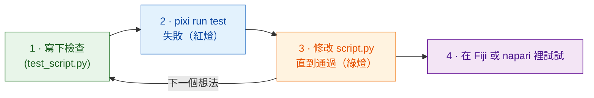

# 先寫測試

!!! success "強烈建議：每次修改都從這裡開始"
    你*可以*跳過測試，直接到 Fiji 或 napari 裡試。但在寫程式碼**之前**先寫好檢查，
    是最能省時間的習慣；當程式碼是由 **AI 助理**幫你寫的時候，這一點尤其重要（見下文）。

## 用白話說

廚師在下鍋**之前**就決定好這道菜該是什麼味道，然後邊煮邊嚐。
**測試**就是把這個決定寫下來：一個小小的檢查，拿一張自己造出來的影像跑你的
`run` 函式，告訴你*通過*還是*失敗*，而且**完全不用開 Fiji 或 napari**。
先寫測試再寫程式，就叫做*測試驅動開發*（test-driven development，TDD）。

Wavu 給你一個 Fiji 和 napari 的替身 `FakeCtx`，它會把 Log 訊息和進度記錄下來，
而不是顯示出來。因為同一個腳本在兩邊都能跑，一套測試就能同時涵蓋兩者。



為什麼要先寫？程式碼寫完*之後*才寫的檢查，往往只是在測程式碼做了什麼，
而不是你想要它做什麼。先寫的話，它就是你的計畫；開始動手前看到紅燈，
也證明這個檢查真的有在檢查東西。

## 測試長什麼樣子

範本裡已經有幾個，在 `test_script.py`：

```python
from pathlib import Path
import numpy as np
from wavu.testing import FakeCtx, run_script

SCRIPT = Path(__file__).with_name("script.py")


def test_blur_smooths_a_single_bright_pixel():
    img = np.zeros((32, 32), dtype=np.uint16)
    img[16, 16] = 1000                         # 一個亮點
    ctx = FakeCtx()
    out = run_script(SCRIPT, {"image": img}, {"sigma": 2.0}, ctx=ctx)

    assert out["blurred"].shape == img.shape   # 傳回的大小一樣
    assert out["blurred"][16, 16] < 1000       # 亮點變柔和了
    assert ctx.progress_values[-1] == 1.0      # 進度到了 100 %
```

- `run_script` 會像 Fiji 或 napari 一樣呼叫你的 `run`，你沒給的參數會用 `PARAMS`
  裡的預設值補上。
- `ctx.messages` 存著你寫過的所有 Log；`ctx.progress_values` 存著每一個進度值。
- `FakeCtx(cancel_after=2)` 會假裝使用者在兩次檢查之後取消了（在 Fiji 按 Esc，在 napari 按 **Cancel**），
  讓你測試取消功能是否正常。

為新想法寫的**第一個測試**可以就這麼小：做一張你已經知道答案的影像
（一個亮的方塊、兩個分開的斑點），然後斷言（assert）這個答案
（`labels.max() == 2`）。

## 執行測試 { #run-the-tests }

這是唯一一個用終端機最簡單的地方。在 VS Code 裡選
**Terminal › New Terminal**（它會在你的腳本資料夾裡開啟），然後輸入：

```sh
pixi run test
```

你應該會看到一小排點，以及像 `3 passed in 1.2s` 這樣的摘要。
如果出現紅色的 `F` 和 `failed`，表示有一項檢查沒通過；上面的文字會告訴你是哪一行、為什麼。

!!! tip "終端機裡沒有 `pixi`？"
    如果你是連同 Wavu 一起安裝 napari 的，你已經有 pixi 了。Fiji 下載的 pixi 放在看不到的地方。要在終端機使用，請從
    [pixi.sh](https://pixi.sh) 安裝一次 pixi，然後關掉終端機再重新開啟。

    === "Windows"

        ```powershell
        powershell -ExecutionPolicy ByPass -c "irm -useb https://pixi.sh/install.ps1 | iex"
        ```

    === "macOS / Linux"

        ```sh
        curl -fsSL https://pixi.sh/install.sh | sh
        ```

    之後執行 `pixi --version` 會印出版本號碼。

## 和 AI 助理一起工作

程式設計助理（Claude、Copilot、ChatGPT……）寫程式碼很快，語氣也總是很有把握，
就算程式碼是錯的也一樣。測試是一個它們沒辦法用話術繞過去的約定：

1. 由**你**來寫或確認測試：輸入的影像，以及你預期的答案。
2. 請助理：*「在不修改測試的前提下，讓 `pixi run test` 通過。」*
3. 在相信結果之前，**自己執行測試**，然後再到 Fiji 或 napari 裡試試。

助理寫的測試，要像它寫的程式碼一樣仔細讀：一個永遠不會失敗的檢查，什麼也保護不了。

## 一句話總結

先寫檢查，看它失敗，修改 `script.py` 直到 `pixi run test` 通過，然後才到 Fiji 或 napari 裡試。

[下一步：從筆記本到 Wavu :material-arrow-right:](from-notebook.md){ .md-button }
