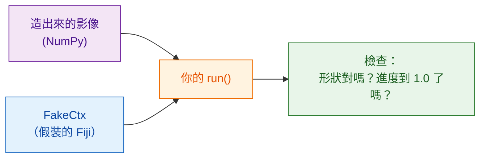

# 不用 Fiji 也能測試

!!! note "選用"
    就算從來不做這件事，你也能寫出好用的腳本。等腳本變大，或在分享出去之前，它就很值得了。

## 用白話說

廚師在端菜之前會先嚐一口醬汁；沒有人想在客人的餐桌上才發現錯誤。
**測試**是一個小小的檢查：拿一張自己造出來的影像跑你的 `run` 函式，確認答案看起來對，
而且**完全不用開 Fiji**。Wavu 給你一個 Fiji 的替身 `FakeCtx`，
它會把 Log 訊息和進度記錄下來，而不是顯示出來。



## 測試長什麼樣子

範本裡已經有一個，在 `test_script.py`：

```python
from pathlib import Path
import numpy as np
from wavu.testing import FakeCtx, run_script

SCRIPT = Path(__file__).with_name("script.py")


def test_blur_smooths_a_single_bright_pixel():
    img = np.zeros((32, 32), dtype=np.uint16)
    img[16, 16] = 1000                         # 一個亮點
    ctx = FakeCtx()
    out = run_script(SCRIPT, {"image": img}, {"sigma": 2.0}, ctx=ctx)

    assert out["blurred"].shape == img.shape   # 傳回的大小一樣
    assert out["blurred"][16, 16] < 1000       # 亮點變柔和了
    assert ctx.progress_values[-1] == 1.0      # 進度到了 100 %
```

- `run_script` 會像 Fiji 一樣呼叫你的 `run`，你沒給的參數會用 `PARAMS`
  裡的預設值補上。
- `ctx.messages` 存著你寫過的所有 Log；`ctx.progress_values` 存著每一個進度值。
- `FakeCtx(cancel_after=2)` 會假裝使用者在兩次檢查之後按了 Esc，
  讓你測試取消功能是否正常。

## 執行測試 { #run-the-tests }

這是唯一一個用終端機最簡單的地方。在 VS Code 裡選
**Terminal › New Terminal**（它會在你的腳本資料夾裡開啟），然後輸入：

```sh
pixi run test
```

你應該會看到一小排點，以及像 `3 passed in 1.2s` 這樣的摘要。
如果出現紅色的 `F` 和 `failed`，表示有一項檢查沒通過；上面的文字會告訴你是哪一行、為什麼。

!!! tip "終端機裡沒有 `pixi`？"
    Fiji 下載的 pixi 放在看不到的地方。要在終端機使用，請從
    [pixi.sh](https://pixi.sh) 安裝一次 pixi，然後關掉終端機再重新開啟。

    === "Windows"

        ```powershell
        powershell -ExecutionPolicy ByPass -c "irm -useb https://pixi.sh/install.ps1 | iex"
        ```

    === "macOS / Linux"

        ```sh
        curl -fsSL https://pixi.sh/install.sh | sh
        ```

    之後執行 `pixi --version` 會印出版本號碼。

## 用真實的影像測試

你也可以不開 Fiji，直接用一個 TIFF 檔試跑整個腳本，並把結果存到一個資料夾：

```sh
pixi run wavu run script.py --in image=cells.tif --param sigma=3 --out results
```

## 一句話總結

`FakeCtx` 和 `run_script` 讓你用 `pixi run test` 在一張小小的假影像上檢查
`run`，錯誤就會在 Fiji 或同事看到之前先現形。

[下一步：分享給實驗室 :material-arrow-right:](../share/with-your-lab.md){ .md-button }
